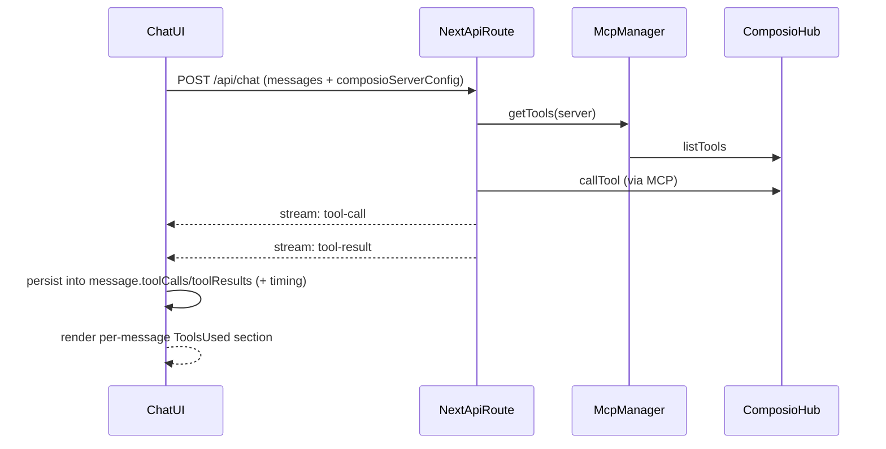

# Composio Tool-Calling (World-Class)

## Goals

- Make **Composio the only tool-calling integration** path (no arbitrary MCP marketplace/custom servers), while supporting **multiple Composio connections** (add more tools over time).
- Show **tools being called** in the chat transcript **under each assistant message** (summary-first, expandable details).
- Production-grade safety: strict URL rules, secret handling, caps, and good failure UX.

## Current state (already in repo)

- MCP runtime + tool injection is implemented via [`/home/umer/Documents/Github/llm-frontend/src/lib/mcp/mcp-manager.ts`](/home/umer/Documents/Github/llm-frontend/src/lib/mcp/mcp-manager.ts) and used by chat route [`/home/umer/Documents/Github/llm-frontend/src/app/api/chat/route.ts`](/home/umer/Documents/Github/llm-frontend/src/app/api/chat/route.ts).
- Tool-call events are parsed and persisted during streaming in [`/home/umer/Documents/Github/llm-frontend/src/hooks/use-chat.ts`](/home/umer/Documents/Github/llm-frontend/src/hooks/use-chat.ts).
- UI already supports a collapsible per-message tool section in [`/home/umer/Documents/Github/llm-frontend/src/components/chat/message-item.tsx`](/home/umer/Documents/Github/llm-frontend/src/components/chat/message-item.tsx).

## Gaps to close for “super polished”

- **Composio-only enforcement**: registry/UI currently support arbitrary MCP servers and custom add.
- **Composio onboarding UX**: users need clear, in-app instructions to add more tools in Composio and then connect them here.
- **Composio multi-connection UX**: needs “Add connection” (name + MCP URL + API key), test, tool list, and per-tool toggles.
- **Tool-call UX polish**: show status (running/succeeded/failed), duration, and clean summaries; avoid leaking secrets in logs/UI.
- **Security**: tighten remote URL rules to an allowlist (Composio domains only), reduce SSRF surface; remove overly verbose logging of tool args/results.

## Target UX (what you asked for)

- In each assistant message:
  - A compact line like “**3 tools used**: Gmail Search, Web Search, Calendar Create”
  - Expand to show per-tool:
    - **Status** (running/done/error)
    - **Duration** (ms)
    - Optional “View details” JSON for args/result

## Implementation outline

### 1) Composio-only integration surface

- Restrict the MCP registry in [`/home/umer/Documents/Github/llm-frontend/src/lib/mcp/registry.ts`](/home/umer/Documents/Github/llm-frontend/src/lib/mcp/registry.ts) to **only** Composio.
- Replace/trim the marketplace UI in [`/home/umer/Documents/Github/llm-frontend/src/components/settings/mcp-marketplace.tsx`](/home/umer/Documents/Github/llm-frontend/src/components/settings/mcp-marketplace.tsx) into **Settings → Integrations → Composio**:
  - “How to add more tools” instructions (deep links to Composio)
  - “Add connection” form (name + MCP URL + API key)
  - Per-connection “Test” (listTools) + cached tool list preview
  - Per-tool enable/disable toggles (denylist)

### 2) Connection + tool governance model

- Keep using Dexie `mcpServers` (already in [`/home/umer/Documents/Github/llm-frontend/src/lib/db/schema.ts`](/home/umer/Documents/Github/llm-frontend/src/lib/db/schema.ts)) but enforce:
  - **multiple records allowed**, but **all must be Composio hostnames** (Composio-only)
  - a user-friendly `name` per connection (e.g. “Composio: Gmail + Calendar”)
  - cached `tools` + `toolPolicy.disabledTools` + `toolCaps`
  - `status/lastConnectedAt/error` updated by Test Connection flow

### 3) Hardening `McpManager` for Composio

- In [`/home/umer/Documents/Github/llm-frontend/src/lib/mcp/mcp-manager.ts`](/home/umer/Documents/Github/llm-frontend/src/lib/mcp/mcp-manager.ts):
  - Enforce a **domain allowlist** (Composio-only) rather than generic HTTPS+private-IP prefix checks.
  - Ensure correct auth header for Composio (`x-api-key`) is the default.
  - Gate or redact logs that may print secrets/tool args/tool results.

### 4) Tool-call persistence + UI polish

- In [`/home/umer/Documents/Github/llm-frontend/src/hooks/use-chat.ts`](/home/umer/Documents/Github/llm-frontend/src/hooks/use-chat.ts):
  - Extend stored tool events to include `startedAt` and `endedAt` (or `durationMs`) per `toolCallId`.
  - Mark failures (when `tool-result` indicates error or when stream sends `type: error`).
- In [`/home/umer/Documents/Github/llm-frontend/src/components/chat/message-item.tsx`](/home/umer/Documents/Github/llm-frontend/src/components/chat/message-item.tsx):
  - Render **summary-first** (already matches your preference), but add status + duration badges.
  - Keep details behind “View details” to stay clean.

### 5) End-to-end validation

- Manual checklist:
  - Tool call appears while streaming ("running"), then completes ("done" + duration).
  - Refresh page → tool-call history remains visible for the message.
  - Tool toggles disable specific Composio tools and they no longer appear in tool list or can be called.
  - URL validation rejects non-Composio domains.

## Data flow

## Notes / defaults

- Since you chose **Composio-only**, we’ll simplify security by allowing only `*.composio.dev` (and any other official Composio MCP hostnames you confirm), while still allowing **many Composio connections**.