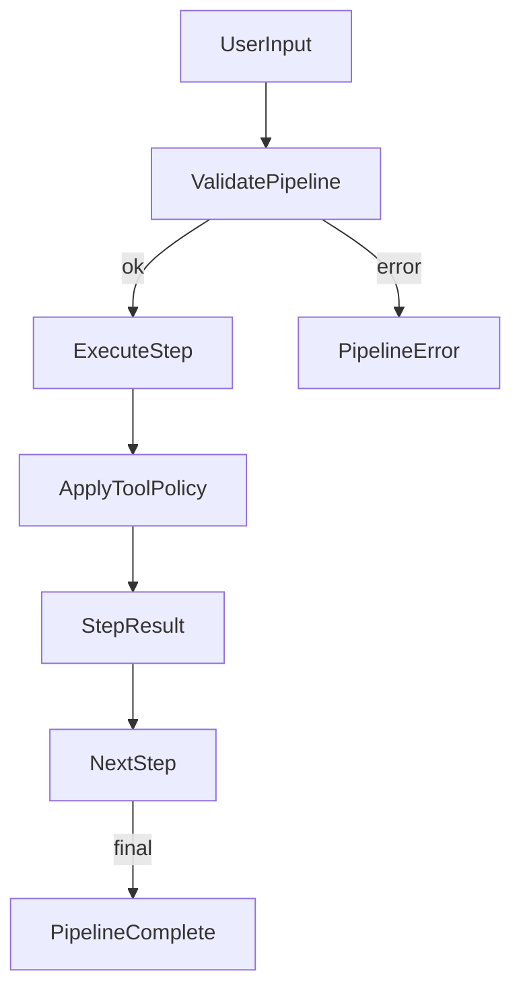

# Harden Agent Integration

## Objectives

- Make pipeline execution safer and more deterministic
- Enforce tool access policies consistently across chat, pipeline, and direct tool calls
- Polish agent creation and pipeline visualization UX so it feels production‑grade

## Key gaps to address

- Disabled tool policies are saved but not enforced in chat/pipeline/tool execution
- Pipeline tool argument substitution can crash on non‑string JSON values
- Pipeline editor allows invalid configs with little guidance; visual view lacks tool-step add
- Step‑level errors are generic; limited UI feedback for missing config

## Plan

1. **Centralize tool policy enforcement**

   - Add a small helper to filter MCP tools by server enablement + `toolPolicy.disabledTools` + agent `mcpToolPolicy` + optional step `enabledTools` allowlist.
   - Apply this in:
     - [`src/app/api/chat/route.ts`](/home/umer/Documents/Github/llm-frontend/src/app/api/chat/route.ts)
     - [`src/app/api/agents/pipeline/route.ts`](/home/umer/Documents/Github/llm-frontend/src/app/api/agents/pipeline/route.ts)
     - [`src/app/api/mcp/execute-tool/route.ts`](/home/umer/Documents/Github/llm-frontend/src/app/api/mcp/execute-tool/route.ts)
   - Ensure tool execution rejects disabled tools with a clear, sanitized error.

2. **Harden pipeline runtime validation**

   - Add pre‑execution validation for pipeline steps (missing required fields, invalid toolName/agentId, duplicate output variables, unresolved `{{var}}` placeholders, non‑linear edges).
   - Improve step error payloads (include `stepIndex`, `stepId`, and actionable message) in pipeline SSE events.
   - Make tool argument substitution safe for non‑string values (stringify or skip substitution) in `executeToolStep`.

3. **Polish agent creation + pipeline visualization**

   - Add inline validation + warnings in the agent editor for pipeline steps and disable Save if invalid.
   - Add Tool step to visual “Add Node” menu and show missing‑config badges on nodes.
   - Improve NodeConfigPanel guidance (e.g., empty toolName/agentId prompts, highlight required fields).
   - Files: [`src/components/agents/agent-editor-dialog.tsx`](/home/umer/Documents/Github/llm-frontend/src/components/agents/agent-editor-dialog.tsx), [`src/components/agents/pipeline/pipeline-canvas.tsx`](/home/umer/Documents/Github/llm-frontend/src/components/agents/pipeline/pipeline-canvas.tsx), [`src/components/agents/pipeline/node-config-panel.tsx`](/home/umer/Documents/Github/llm-frontend/src/components/agents/pipeline/node-config-panel.tsx)

4. **Consistency + UX feedback**

   - Standardize user‑visible error messages for pipeline/tool failures.
   - Ensure UI shows step‑level failures and retry status clearly in pipeline progress.
   - Update schema types only if needed for safer tool args handling.

## Execution Flow (hardened)

## Implementation Todos

- **tool-policy**: Add tool policy filter helper and apply across chat/pipeline/tool routes
- **pipeline-validate**: Add runtime pipeline validation + safe tool args substitution
- **editor-polish**: Add UI validation, missing‑config badges, and tool step in visual add menu
- **ux-errors**: Improve pipeline error events and display in UI