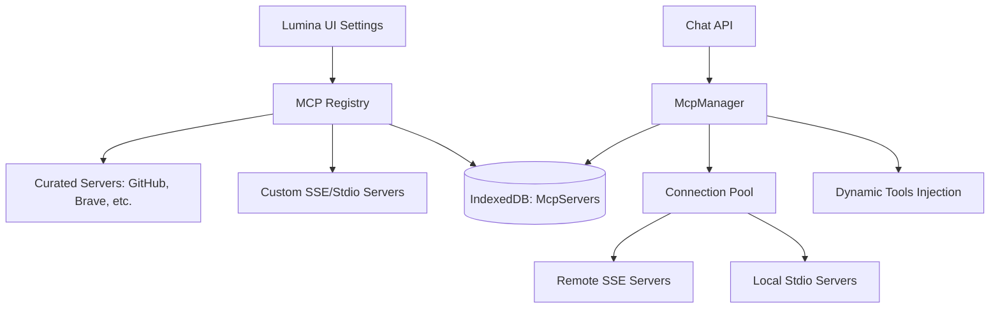

# MCP Marketplace & Plugin System

This plan outlines the implementation of an MCP (Model Context Protocol) Marketplace in Lumina. Unlike static tools, MCP servers are dynamic plugins that can expose multiple tools, resources, and prompts through a standardized protocol.

### 1. Architectural Overview

We will implement a hybrid marketplace: a curated registry of official/popular MCP servers combined with the ability for users to add custom servers.

### 2. Key Differences: Tools vs. MCP Servers

| Feature | Hardcoded Tools (Current) | MCP Servers (Superpowers) |

|---------|---------------------------|---------------------------|

| **Scope** | Single function (e.g., Search) | Collection of Tools + Resources + Prompts |

| **Extensibility** | Requires code changes | Plug-and-play via URL or Command |

| **Dynamic** | Fixed schema | Discovery at runtime |

| **Ecosystem** | Built by us | Community-driven (Anthropic, OpenAI, etc.) |

### 3. Implementation Steps

#### Infrastructure

- Complete [`src/lib/mcp/mcp-manager.ts`](src/lib/mcp/mcp-manager.ts) to handle connection pooling and health checks.
- Implement SSE transport for remote servers and Stdio transport for local servers (using `npx` or `uvx`).
- Enhance [`src/lib/db/schema.ts`](src/lib/db/schema.ts) to persist server configurations and encrypted API keys.

#### Marketplace UI

- Create `src/components/settings/mcp-marketplace.tsx` featuring a gallery of curated servers.
- Implement "Connect" flow: User selects a server -> Enters required API keys -> Manager validates connection -> Tools become available.

#### Dynamic Integration

- Update [`src/app/api/chat/route.ts`](src/app/api/chat/route.ts) to fetch active MCP tools from the `McpManager` and inject them into the Vercel AI SDK `tools` object.

### 4. Essential Files to Create/Modify

- [`src/lib/mcp/mcp-manager.ts`](src/lib/mcp/mcp-manager.ts): Core logic for managing multiple MCP clients.
- [`src/components/settings/mcp-settings.tsx`](src/components/settings/mcp-settings.tsx): The new Marketplace UI.
- [`src/lib/db/schema.ts`](src/lib/db/schema.ts): Database storage for servers.
- [`src/app/api/chat/route.ts`](src/app/api/chat/route.ts): Integration with the LLM.