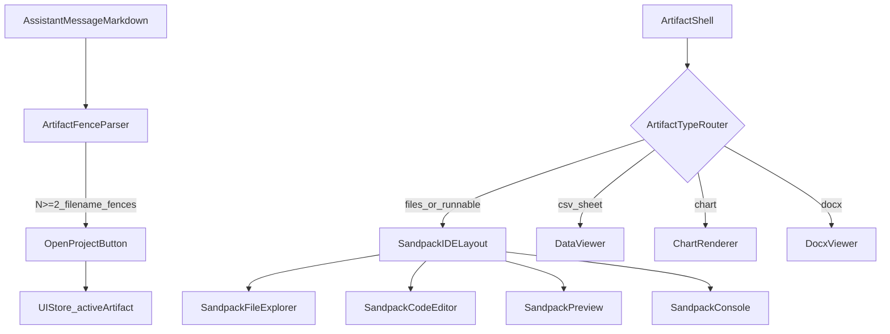

# Plan: Topnotch Artifacts IDE (Sandpack-only, $0 BYOK)

This plan keeps your product **end-to-end BYOK with no cost on you**, while making Artifacts feel like a mini VSCode: folder tree, multi-file projects, and runnable client/server-style sandboxes.

## What’s proven in your repo (no guessing)

- Your installed `@codesandbox/sandpack-react` already ships:
  - `SandpackFileExplorer`, `SandpackLayout`, `SandpackCodeEditor`, `SandpackPreview`, `SandpackConsole`
  - Templates: `react`, `react-ts`, `vanilla`, `vanilla-ts`, `vue`, `vue-ts`, `angular`, `svelte`, `solid`, `node`, `nextjs`, `vite`, plus `vite-*` variants.

## Key constraints (so expectations are correct)

- **“Node server” runs in-browser** via Sandpack’s runtime/template.
  - Great for demos and full-stack-like examples.
  - Not a real network server on your machine (no true port binding for your LAN).
  - Some npm packages won’t work (native/binary modules, node-gyp builds, etc.).
- **Security**: we will **not** auto-inject any of your BYOK secrets into sandboxes.

## 1) Add multi-file project support end-to-end

- Update the `Artifact` type in [`src/stores/ui-store.ts`](src/stores/ui-store.ts):
  - Add `files?: Record<string, string>` (paths like `src/App.tsx` produce a real folder tree).
  - Add optional `template?: SandpackPredefinedTemplate` and `entry?: string` (for precise runs).

## 2) Parse LLM “filename code fences” (your chosen format)

- Enhance markdown code-fence handling in [`src/components/markdown/markdown-renderer.tsx`](src/components/markdown/markdown-renderer.tsx) so we can read fence “meta” (e.g. `filename=src/App.tsx`).
- Add a small parser utility, e.g. [`src/lib/utils/artifact-fence-parser.ts`](src/lib/utils/artifact-fence-parser.ts):
  - Extract **all** fenced blocks that include a filename.
  - Return `{ path, language, code }[]`.
- In [`src/components/chat/message-item.tsx`](src/components/chat/message-item.tsx), when an assistant message contains + file fences:
  - Show an **“Open project”** button (one-click) that creates a single multi-file Artifact and opens the artifact pane.

## 3) Redesign `SandpackExecutor` into an IDE layout (folder tree + editor + preview + console)

- Replace the current single `Sandpack` usage in [`src/components/artifacts/sandpack-executor.tsx`](src/components/artifacts/sandpack-executor.tsx) with:
  - `SandpackProvider` + `SandpackLayout`
  - Left: `SandpackFileExplorer`
  - Center: `SandpackCodeEditor`
  - Right/bottom: `SandpackPreview` + `SandpackConsole` (toggle + resizable panels)
- Remove `window.location.reload()` reset; instead remount Sandpack via a `key`/state for a clean UX.
- Use the correct template selection:
  - If artifact includes `package.json`/Vite/Next markers → choose `vite`/`nextjs`.
  - Else map by language: `react(-ts)`, `vue(-ts)`, `angular`, `svelte`, `node`, etc.

## 4) Auto-deps (safe + reliable)

- Implement a dependency strategy that doesn’t break often:
  - Prefer dependencies declared in `/package.json` inside the sandbox files.
  - Optionally add “smart defaults” only for common libs you already ship (e.g. `recharts`) when imports are detected.
  - Avoid aggressive “install latest everything” heuristics (this is where sandboxes get flaky).

## 5) Add rich non-code viewers (Artifacts beyond Sandpack)

- Create [`src/components/artifacts/data-viewer.tsx`](src/components/artifacts/data-viewer.tsx):
  - CSV/TSV parsing (add `papaparse`), render with `@tanstack/react-table` (already present).
  - “Sheets-like” UX: sticky header, sort/filter, copy cells, export CSV.
- Create [`src/components/artifacts/chart-renderer.tsx`](src/components/artifacts/chart-renderer.tsx):
  - Render a small, opinionated JSON chart spec using `recharts` (already present).
- Create [`src/components/artifacts/docx-viewer.tsx`](src/components/artifacts/docx-viewer.tsx):
  - Render docx-derived HTML (via `mammoth`, already present) with sanitization (add a sanitizer dependency if needed).

## 6) Route everything in `ArtifactShell`

- Update [`src/components/artifacts/artifact-shell.tsx`](src/components/artifacts/artifact-shell.tsx) routing:
  - If `artifact.files` exists → show IDE.
  - If language is runnable (`react`, `vue`, `angular`, `svelte`, `node`, `nextjs`, `vite`, js/ts/tsx/jsx) → show IDE.
  - If `csv`/`tsv`/`sheet` → `DataViewer`.
  - If `chart` → `ChartRenderer`.
  - If `docx`/`word` → `DocxViewer`.
