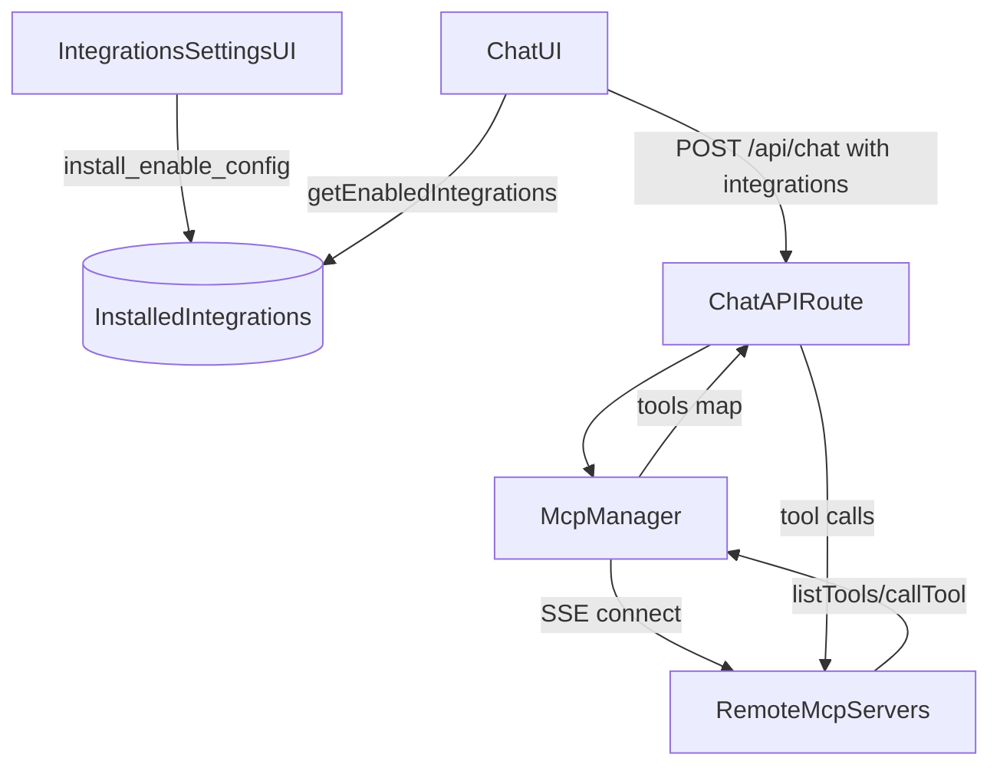

# Unified Integrations Marketplace (Remote MCP only)

### Goals

- **Unify “Connectors” + “Plugins” into one concept: Integrations** (remote MCP servers only).
- **Deprecate legacy connectors** (no `@notion:` injection; no `ConnectorsSettings`).
- Provide **industry-standard marketplace primitives**: curated registry manifest, install records, per-integration config (secrets), enable/disable, health status, safe execution.
- Deliver a **power-user friendly “connect once” path** via curated **Integration Hubs** (a single remote MCP endpoint that can expose many app tools like Gmail/Drive/Sheets/Notion/SQL once configured on the hub side), while still supporting custom MCP URLs.
- Provide **global tool governance inside Lumina**: per-server enable/disable and per-tool enable/disable (client-side filtering), plus “Test connection” to validate the MCP endpoint and show discovered tool count.

### Current state (what we’re building on)

- **Legacy connectors**: static `availableConnectors` registry + `ConnectorsSettings` UI; Notion is mock and powers `@notion:` injection in `context-builder`.
  - Files: [`/home/umer/Documents/Github/llm-frontend/src/lib/connectors/registry.ts`](/home/umer/Documents/Github/llm-frontend/src/lib/connectors/registry.ts), [`/home/umer/Documents/Github/llm-frontend/src/components/settings/connectors-settings.tsx`](/home/umer/Documents/Github/llm-frontend/src/components/settings/connectors-settings.tsx), [`/home/umer/Documents/Github/llm-frontend/src/lib/ai/context-builder.ts`](/home/umer/Documents/Github/llm-frontend/src/lib/ai/context-builder.ts)
- **MCP marketplace (already remote-only in code)**: installs records in IndexedDB (`mcpServers`), can pass enabled servers to `/api/chat`, which connects via SSE and injects tools.
  - Files: [`/home/umer/Documents/Github/llm-frontend/src/components/settings/mcp-marketplace.tsx`](/home/umer/Documents/Github/llm-frontend/src/components/settings/mcp-marketplace.tsx), [`/home/umer/Documents/Github/llm-frontend/src/lib/mcp/mcp-manager.ts`](/home/umer/Documents/Github/llm-frontend/src/lib/mcp/mcp-manager.ts), [`/home/umer/Documents/Github/llm-frontend/src/app/api/chat/route.ts`](/home/umer/Documents/Github/llm-frontend/src/app/api/chat/route.ts)

### Proposed architecture

#### 0) Integration Hubs (best UX with minimal Lumina complexity)

We prioritize a curated “Integration Hub” entry type: users do OAuth/app linking inside the hub, and Lumina connects to **one remote MCP server**.\n\nThis yields the best “connect once” UX without Lumina hosting OAuth/token refresh.\n\nLumina responsibilities:\n- store MCP endpoint URL (+ optional key) as a normal installed integration\n- test connection (`listTools`) and show status\n- allow global tool toggles by filtering tools before injecting into chat\n\nHub responsibilities (external):\n- OAuth, token refresh, app-to-action mapping, and tool exposure.\n+

#### 1) One registry type: `IntegrationDefinition` (curated, in-repo)

Create a versioned, static curated registry module (TS or JSON) that defines “what can be installed”.

- New file: [`/home/umer/Documents/Github/llm-frontend/src/lib/integrations/registry.ts`](/home/umer/Documents/Github/llm-frontend/src/lib/integrations/registry.ts)
- Key fields (industry-practice oriented):
  - `id`, `name`, `description`, `publisher`, `homepageUrl`, `logoUrl`, `categories[]`
  - `kind: "hub" | "direct"` (UI grouping + copy; all are remote SSE)
  - `transport: "sse"` (only)
  - `sse.urlTemplate` (may include placeholders like `{BASE_URL}` or `{REGION}`)
  - `auth` schema for UI + runtime headers (e.g. apiKey in `Authorization: Bearer <key>` or custom header)
  - `trust`/`privacy` metadata (what data may be sent; link to policy)
  - `setup` block for hubs (short instructions + deep links) so onboarding doesn’t feel “paste random URL”

#### 2) One installed-record type: `InstalledIntegration` (user state)

Replace/rename `McpServer` to a unified integration record stored in IndexedDB.

- Modify: [`/home/umer/Documents/Github/llm-frontend/src/lib/db/schema.ts`](/home/umer/Documents/Github/llm-frontend/src/lib/db/schema.ts)
  - Add `installedIntegrations` table (or rename `mcpServers` → `integrations`), with:
    - `id` (local install id), `definitionId?` (for curated), `name`, `url`, `enabled`, timestamps
    - `secrets` (minimally: `apiKey`), plus `authType`/header name if needed
    - `status`, `lastConnectedAt`, `lastError`
    - `toolPolicy` (global, per-integration): either denylist or allowlist (start with denylist for “turn off a few tools” UX)
    - `cachedTools` (the last discovered tools, with server-reported metadata like description and input schema if available)
    - **Remote-only**: drop `stdio` fields and `type: "stdio"` (or keep temporarily for migration, but enforce `sse` in code)
- Modify queries: [`/home/umer/Documents/Github/llm-frontend/src/lib/db/queries.ts`](/home/umer/Documents/Github/llm-frontend/src/lib/db/queries.ts)
  - Rename `getEnabledMcpServers()` → `getEnabledIntegrations()` and migrate call sites.

#### 3) One settings UI: `IntegrationsSettings`

Replace both “Connectors” and “Plugins” tabs with a single “Integrations” page.

- Modify: [`/home/umer/Documents/Github/llm-frontend/src/app/settings/page.tsx`](/home/umer/Documents/Github/llm-frontend/src/app/settings/page.tsx)
  - Remove the `connectors` tab.
  - Rename `mcp` tab label from “Plugins” → **Integrations**.
  - Fix `allowedTabs` to include `mcp` (currently missing) so deep links work.
- Replace/rename UI component:
  - Rename [`/home/umer/Documents/Github/llm-frontend/src/components/settings/mcp-marketplace.tsx`](/home/umer/Documents/Github/llm-frontend/src/components/settings/mcp-marketplace.tsx) → `integrations-marketplace.tsx` (or keep file but rename exported component) and update copy:
    - “Installed Integrations” + “Registry” tabs
    - “Integration Hubs” appear at the top of the Registry and are presented as the recommended path for Google/Notion/Gmail/Sheets/Drive-style coverage
    - “Add Custom (SSE URL)” flow stays, but with:
      - explicit warnings (SSRF/privacy),
      - URL validation (https only, no localhost/private IPs),
      - optional header format selection (defaults to `Authorization: Bearer`).
    - Add “Test connection” per installed integration:
      - calls `listTools` once (through existing MCP client code path)
      - stores `status/lastError/lastConnectedAt/cachedTools`
    - Add “Tool toggles” per installed integration (global):
      - show tool list from cache (or re-discover)
      - allow enabling/disabling individual tools (stored in `toolPolicy`)

#### 4) Chat/tool injection remains server-side, but becomes “Integrations-aware”

- Modify: [`/home/umer/Documents/Github/llm-frontend/src/hooks/use-chat.ts`](/home/umer/Documents/Github/llm-frontend/src/hooks/use-chat.ts)
  - Send `integrations: await getEnabledIntegrations()` instead of `mcpServers`.
- Modify: [`/home/umer/Documents/Github/llm-frontend/src/app/api/chat/route.ts`](/home/umer/Documents/Github/llm-frontend/src/app/api/chat/route.ts)
  - Update request schema to accept `integrations`.
  - Enforce remote-only constraints again server-side:
    - validate URL scheme
    - block private ranges / localhost
    - cap number of integrations/tools per request
- Modify: [`/home/umer/Documents/Github/llm-frontend/src/lib/mcp/mcp-manager.ts`](/home/umer/Documents/Github/llm-frontend/src/lib/mcp/mcp-manager.ts)
  - Rename public API to accept `InstalledIntegration`.
  - Improve namespacing: prefer stable `integrationId/toolName` format.
  - Enforce `toolPolicy` filtering (global per-tool toggles) when building the injected tools object.
  - Add lightweight health tracking hooks (connect/listTools failures recorded so UI can show status).

#### 5) Deprecate legacy connectors (behavior + UX)

- Remove Notion special-casing and connector injection path:
  - Modify: [`/home/umer/Documents/Github/llm-frontend/src/lib/ai/context-builder.ts`](/home/umer/Documents/Github/llm-frontend/src/lib/ai/context-builder.ts)
    - Remove parsing and injection for `@notion:`.
  - Modify: [`/home/umer/Documents/Github/llm-frontend/src/components/chat/input-area.tsx`](/home/umer/Documents/Github/llm-frontend/src/components/chat/input-area.tsx)
    - Remove “Search Notion” mention item.
- Remove connectors UI + registry usage:
  - Delete or orphan (depending on your preference) connector files:
    - [`/home/umer/Documents/Github/llm-frontend/src/components/settings/connectors-settings.tsx`](/home/umer/Documents/Github/llm-frontend/src/components/settings/connectors-settings.tsx)
    - [`/home/umer/Documents/Github/llm-frontend/src/lib/connectors/registry.ts`](/home/umer/Documents/Github/llm-frontend/src/lib/connectors/registry.ts)
    - [`/home/umer/Documents/Github/llm-frontend/src/lib/connectors/mock-notion.ts`](/home/umer/Documents/Github/llm-frontend/src/lib/connectors/mock-notion.ts)
  - Or keep them temporarily behind a feature flag if you want a gradual rollout.

### Data flow (target)

### Security & “industry practices” we’ll implement (remote-only)

- **SSRF hardening**: reject localhost, private IP ranges, non-https URLs, suspicious ports.
- **Explicit trust UX** for custom URLs (warn that conversation data may be sent).
- **Auth standardization**: support at least bearer-token auth; optionally custom header.
- **Least privilege (now)**: allow disabling whole integrations and disabling individual tools (global per-tool toggles enforced at injection time).
- **Caps**: cap enabled integrations per request and cap total injected tools to prevent slow/overloaded chats.

### Migration strategy

- Minimal migration: keep existing `mcpServers` table name initially but treat it as `InstalledIntegration` internally, then optionally rename later.
- Remove connectors UI and parsing first (since you chose full deprecate), and rely on MCP integrations for future Notion/GDrive/Slack functionality.

### Rollout / milestones

- Milestone A: Registry + unified UI naming + remove connectors tab.
- Milestone B: Add “Test connection” + cache discovered tools; add global per-tool toggles.
- Milestone C: Replace request field `mcpServers` → `integrations` and update tool injection to enforce tool policy.
- Milestone D: Remove `@notion:` + legacy connector code.
- Milestone E: Add URL safety + better status/health reporting + caps.