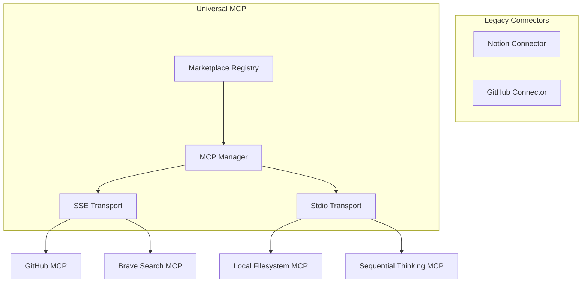

# Unified MCP Marketplace & Superpowers

This plan transitions Lumina to an "MCP-first" architecture, replacing the fragmented "Connectors" system with a universal Model Context Protocol (MCP) Marketplace.

### 1. Vision: Universal Extensibility

- **Standardized**: One protocol to rule them all. No more custom API wrappers.
- **Extensible**: Users can connect to *any* MCP server in the world.
- **Powerful**: Support for both Remote (SSE) and Local (Stdio/`npx`) servers.

### 2. Implementation Strategy

#### Phase 1: Core MCP Engine

- **McpManager**: A robust client manager in [`src/lib/mcp/mcp-manager.ts`](src/lib/mcp/mcp-manager.ts) that handles:
    - Connection pooling for multiple servers.
    - SSE transport (for remote services).
    - Stdio transport (for local commands like `npx @modelcontextprotocol/server-github`).
    - Tool, Resource, and Prompt discovery.
- **Persistence**: Store server configs (URLs, commands, API keys) in IndexedDB via [`src/lib/db/schema.ts`](src/lib/db/schema.ts).

#### Phase 2: The Marketplace UI

- **Marketplace Gallery**: A new settings page `src/components/settings/mcp-marketplace.tsx` featuring:
    - **Curated Servers**: Pre-defined templates for popular services (GitHub, Brave Search, Google Maps, Filesystem).
    - **Custom Add**: Ability to add any SSE URL or Stdio command.
    - **Key Management**: Unified way to enter and store credentials for these servers.

#### Phase 3: Integration

- **Chat API**: Update [`src/app/api/chat/route.ts`](src/app/api/chat/route.ts) to dynamically fetch and inject tools from *all* enabled MCP servers into the LLM context.
- **Tool Selector**: Update [`src/components/tools/tool-selector.tsx`](src/components/tools/tool-selector.tsx) to show tools grouped by MCP server.

### 3. Architecture Change

### 4. Key Files

- [`src/lib/mcp/mcp-manager.ts`](src/lib/mcp/mcp-manager.ts) (Major Update)
- [`src/lib/mcp/transports/`](src/lib/mcp/transports/) (New)
- [`src/components/settings/mcp-settings.tsx`](src/components/settings/mcp-settings.tsx) (New)
- [`src/app/api/chat/route.ts`](src/app/api/chat/route.ts) (Integration)